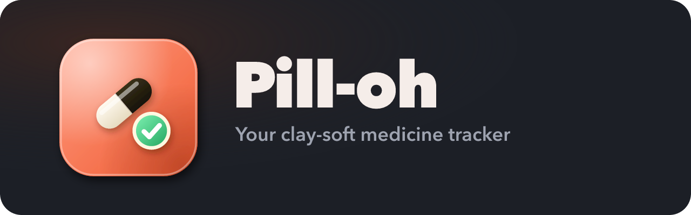

<p align="center">
  
</p>

<p align="center">
  
</p>

<p align="center">
  Tick off every dose, get gentle colour cues as one comes due, and see a report card of how punctual you were —
  all in a soft clay-morphism design. Installable on Android and iPhone.
</p>

---

## Features

- **Dose schedule** — any number of doses a day per medicine, on chosen days, with a sliding week strip.
- **Live status** — doses turn amber as they get close, show a tick when taken, and a cross is added automatically
  when one is missed (you can still mark it as taken later).
- **Report card** — adherence and punctuality over 7 / 30 / 90 days with clay charts, by medicine and by time of day.
  Download a **daily, monthly or quarterly PDF** report.
- **Themes** — Ember Coral (default), Noir Gold, Lavender, Ocean, Rose, Aurora, Teal, or build your own from two colours.
- **Accounts** — case-insensitive usernames, stays signed in, a one-time recovery code at sign-up.
- **Admin console** — admins get a separate view (no personal schedule): totals across all users, who needs
  attention, each user's adherence and full report card (with PDF download), and "forgot password" requests.
- **Dose reminders** — free phone notifications (via the ntfy app) when a dose is due (optionally a few minutes early), a nudge before
  it's marked missed, and optional WhatsApp alerts via Twilio.
- **Installable (PWA)** — home-screen app on Android and iPhone, with rich link previews when shared.

## Quick start

```bash
npm install
npm run dev
```

Open <http://localhost:5173>. With no database configured, everything is saved to `server/.data/local-db.json`.

## Configuration

Copy `.env.example` to `.env` and fill in what you need. `.env` is git-ignored — never commit real values.

| Variable | Purpose |
| --- | --- |
| `DATABASE_URL` | Neon / Postgres connection string. Empty = local JSON file. Tables are created automatically. |
| `SITE_URL` | Public address (e.g. `https://pill-oh.example.com`), needed for link-preview thumbnails and for the picture, icon and "Open Pill-oh" button in ntfy alerts (`public/notify-*.png`). Set before `npm run build`. |
| `ADMIN_USERNAME`, `ADMIN_PASSWORD` | Optional: creates the first admin on startup. |
| `ADMIN_UNLOCK_HASH` | Optional: admin unlock key (32+ random chars) or its Argon2id hash. See [Admins](#admins). |
| `VAPID_PUBLIC_KEY`, `VAPID_PRIVATE_KEY`, `VAPID_SUBJECT` | Push notification keys (`npx web-push generate-vapid-keys`). Auto-generated locally if empty. |
| `NTFY_SERVER`, `NTFY_TOKEN` | Optional: use a self-hosted ntfy server instead of the free public ntfy.sh. |
| `TWILIO_ACCOUNT_SID`, `TWILIO_AUTH_TOKEN`, `TWILIO_WHATSAPP_FROM` | Enables WhatsApp alerts. Optional `TWILIO_*_CONTENT_SID` for approved templates. |
| `PORT`, `TRUST_PROXY` | Server port; set `TRUST_PROXY=1` only behind your own reverse proxy. |
| `CRON_SECRET` | Serverless hosts only: protects `/api/cron/notify`, which sends reminders (see [Deploy on Vercel](#deploy-on-vercel)). |

## Admins

Admins sign in through the small **Admin login** link in the footer of the sign-in page. To make an account an admin,
either set `ADMIN_USERNAME` / `ADMIN_PASSWORD` in `.env`, or promote an existing user:

```bash
npm run make-admin -- <username>            # grant
npm run make-admin -- <username> --revoke   # remove
```

On a hosted deploy (e.g. Vercel) use an **unlock key**: **Admin login** asks only for that key and signs in to a
built-in `admin` account (nobody can sign up with that username).

1. Create a key: `openssl rand -hex 32`, and save it in a password manager.
2. Set `ADMIN_UNLOCK_HASH` in Vercel and redeploy. Either paste the key itself (32+ characters), or — safer — its
   Argon2id hash from `printf %s '<key>' | npm run admin-unlock-hash` (or just `npm run admin-unlock-hash` for a new key).
3. Open **Admin login**, enter the key. Change the key to rotate it; remove the variable to turn this off.

## Install on a phone

The app must be served over HTTPS (any normal host does this).

- **Android (Chrome):** menu ⋮ → **Install app**.
- **iPhone (Safari):** Share → **Add to Home Screen**.

## Reminders

Open **Settings → Dose reminders**.

- **Phone notifications (free, iPhone & Android):** turn it on, install the free [ntfy](https://ntfy.sh) app, tap **+** and subscribe to
  the private topic Pill-oh shows. Needs no admin setup and works on iPhone without installing Pill-oh. Anyone who knows
  a topic can read it, so topics are 128-bit random and can be replaced at any time.
- **WhatsApp (only if the server has Twilio set up):** enter a number with country code; Pill-oh sends a 6-digit code to confirm the number before sending
  any reminders. To try it for free, join the
  [Twilio WhatsApp sandbox](https://www.twilio.com/docs/whatsapp/sandbox) from that phone first.
- The server checks every minute and sends one alert per dose (doses at the same time are grouped). Times follow
  the device's time zone, so reminders stay right when travelling.

## Production

```bash
SITE_URL=https://your-domain npm run build
npm start
```

`npm start` serves the built app and the API from one Node process.

### Deploy on Vercel

The build detects Vercel and packages the API as a Vercel Function next to the static site (`.vercel/output`),
so no extra setup is needed beyond environment variables.

1. Import the repo in Vercel. If the app is in a subfolder, set **Root Directory** to it. Leave the framework preset
   as **Other**; `vercel.json` sets the build command.
2. In **Settings → Environment Variables** add:

   | Variable | Value |
   | --- | --- |
   | `DATABASE_URL` | Required. Neon connection string (the **pooled** one, ending in `?sslmode=require`). |
   | `SITE_URL` | Your Vercel address, e.g. `https://pill-oh.vercel.app` (no trailing slash). |
   | `VAPID_PUBLIC_KEY`, `VAPID_PRIVATE_KEY`, `VAPID_SUBJECT` | Optional (browser push, not shown in the app right now). From `npx web-push generate-vapid-keys`. |
   | `CRON_SECRET` | Long random value (`openssl rand -hex 32`). Needed for reminders. |
   | `ADMIN_USERNAME`, `ADMIN_PASSWORD` | Optional first admin. |
   | `NTFY_*`, `TWILIO_*` | Optional, as above. |

3. **Redeploy** (environment variables only apply to new deployments).
4. Reminders: serverless functions can't run a timer, and Vercel's free Cron runs only once a day. Create a free job at
   [cron-job.org](https://cron-job.org) that calls `https://<your-app>/api/cron/notify` **every minute** with the header
   `Authorization: Bearer <CRON_SECRET>`. Without the right secret the endpoint returns 404.

## Scripts

| Command | What it does |
| --- | --- |
| `npm run dev` | API + web with hot reload |
| `npm run build` | Type-check and build to `dist/` |
| `npm start` | Run the production server |
| `npm run make-admin` | Grant or revoke admin access |
| `npm run admin-unlock-hash` | Create an admin unlock key and its `ADMIN_UNLOCK_HASH` |
| `npm run assets` | Re-render the logo, icons, banner and share image in `public/` |

## Security notes

- Passwords are hashed with Argon2id; recovery codes and session tokens are stored only as SHA-256 hashes.
- Sessions use an HttpOnly, SameSite=Strict cookie (`__Host-` prefixed and Secure in production).
- State-changing requests require a custom header and same-origin `Origin` (CSRF protection), with rate limits on sign-in,
  sign-up and recovery.
- A strict Content-Security-Policy blocks inline and third-party scripts. The service worker never caches `/api` responses.
- Push subscriptions are only accepted for known browser push services, so the server can't be aimed at arbitrary URLs.
  WhatsApp numbers must be verified with a one-time code (hashed, 10-minute expiry, 5 tries, rate-limited).

## Tech

React 19 · Vite · TypeScript · Hono on Node · Postgres (Neon) or a local JSON store.
